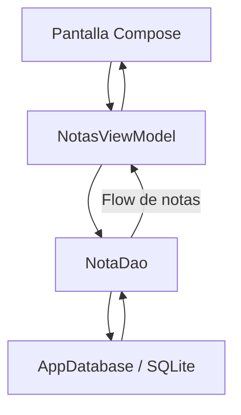

# Laboratorio · MisNotasRoom: SQLite + Room + CRUD

**DSY1105 · Desarrollo de Aplicaciones Móviles · Sección 009V**

**Propósito:** construir una aplicación Android independiente con **una tabla SQLite** administrada por **Room**, mediante Kotlin, Jetpack Compose y operaciones **Create, Read, Update, Delete**. Tiempo sugerido: 2 bloques.

> 🔔 Las «ruiditas» de esta guía son comprobaciones didácticas. El sonido del teléfono es opcional y no sustituye una confirmación real de persistencia.

## Resultado esperado

- Crear una nota de texto válida.
- Mostrar todas las notas, ordenadas desde la más reciente.
- Editar una nota conservando su ID.
- Eliminar una nota.
- Cerrar y reabrir la aplicación conservando los registros.
- Comprobar la tabla con Database Inspector.

## Ruta de aprendizaje (seguir en orden)

1. [01 · Preparación y dependencias](01-preparacion.md)
2. [02 · Tabla y DAO](02-persistencia.md)
3. [03 · ViewModel y pantalla Compose](03-interfaz.md)
4. [04 · Pruebas, inspector y ruiditas](04-verificacion.md)
5. [05 · Desafío, entrega y criterios de término](05-desafio-entrega.md)

Cada archivo se centra en un **scope**. Las guías contienen **fragmentos explicados**; el código completo está en los **archivos fuente reales** del [proyecto de referencia](referencia/), no duplicado dentro de los Markdown.

## Modelo y flujo



Tabla: `notas(id INTEGER PRIMARY KEY, texto TEXT NOT NULL)`. Solo una tabla; sin REST, Navigation, Hilt ni migraciones avanzadas.

## Árbol de referencia

```text
referencia/
├── settings.gradle.kts
├── build.gradle.kts
├── gradle.properties
└── app/
    ├── build.gradle.kts
    └── src/main/
        ├── AndroidManifest.xml
        └── java/cl/duoc/misnotasroom/
            ├── MainActivity.kt
            ├── data/Nota.kt
            ├── data/NotaDao.kt
            ├── data/AppDatabase.kt
            └── ui/NotasViewModel.kt
```

**Primero sigue las guías; utiliza la referencia para contrastar al finalizar cada checkpoint.** El proyecto incluye versiones fijadas en Gradle y el código Kotlin completo. No incluye binarios, cachés Gradle ni un wrapper generado: puede abrirse en Android Studio utilizando una instalación local de Gradle compatible con el Android Gradle Plugin.

## Independencia y alcance

Este lab no continúa labs anteriores ni modifica PocketLog o el proyecto VcM. Conecta conocimientos ya trabajados: Compose, ViewModel, flujos reactivos y validaciones, ahora con persistencia real.
