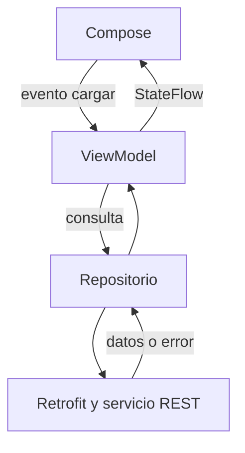

# Retrofit, MVVM y estados en Compose

## Objetivo
Conectar una respuesta HTTP con la interfaz manteniendo responsabilidades claras y sin bloquear la interacción.

## Responsabilidades
- **Retrofit/API:** declara rutas, métodos, parámetros y tipos de respuesta.
- **Repositorio:** encapsula el acceso a datos; la pantalla no conoce URLs.
- **ViewModel:** solicita datos y transforma el resultado en estado de interfaz.
- **Compose:** representa el estado y comunica eventos del usuario.



## Declarar un contrato
```kotlin
interface PublicacionesApi {
    @GET("posts")
    suspend fun listar(@Query("userId") usuario: Int): List<PublicacionDto>
}
```
`@GET` selecciona el método/ruta; `@Query` agrega el filtro. `suspend` permite suspender la corrutina mientras se espera. No significa que cualquier trabajo pesado se traslade automáticamente a otro hilo; Retrofit implementa su llamada suspendida de red sin bloquear el hilo principal. El convertidor transforma el cuerpo en la lista declarada.

La URL base debe terminar en `/`. El permiso `INTERNET` se declara en el manifest fuera de `<application>`; no se solicita mediante un diálogo en ejecución. Usaremos HTTPS.

## El resultado remoto no es todo el estado
Una pantalla necesita representar al menos carga, éxito con datos, éxito vacío y error. El ViewModel puede exponer un `StateFlow<LecturasUiState>` con esos estados; Compose lo observa con `collectAsStateWithLifecycle()`.

Inicia la carga en el ViewModel o como efecto controlado, nunca como llamada suelta dentro del cuerpo de un Composable: la recomposición podría repetirla. Un botón de reintento comunica un evento al ViewModel. Evita solicitudes simultáneas si la anterior sigue activa.

## Manejo de fallos
`IOException` representa problemas de comunicación; `HttpException`, respuestas HTTP no exitosas cuando el contrato devuelve directamente el DTO/lista. También puede fallar la conversión. Mostrar mensajes comprensibles y ofrecer reintento. Una `CancellationException` debe propagarse: cancelar la corrutina no es un error que deba mostrarse al usuario.

## Qué debes poder explicar
Distingue DTO y estado UI; ubica dónde se define la URL y dónde se decide qué mostrar; explica cómo un error deja de mostrar el indicador de carga y cómo se dispara el reintento.

Sigue el [laboratorio completo](../../labs/semana-13-lecturas-remotas/README.md).

Fuentes primarias: [Android: conexión a la red](https://developer.android.com/develop/connectivity/network-ops/connecting), [Lifecycle y Compose](https://developer.android.com/topic/libraries/architecture/lifecycle), [declaraciones de Retrofit](https://lysine.dev/retrofit/declarations/).
